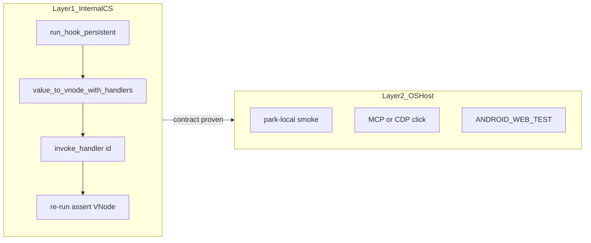

# CleverScript component testing

**Normative** guide for testing tip/client hooks OS-agnostically. The harness lives in **relay-runtime** (`run_hook_persistent`, `VNode`, `HandlerId`, `invoke_handler`). Park and gateway docs only link here.

## Goals

Prove **what the hook emits** and **how handlers change the next tree** — not what a particular OS paints.

| Prefer | Avoid as the primary suite |
|--------|----------------------------|
| VNode text / props / structure | Pixel / CSS layout asserts |
| `invoke_handler(id)` then re-run | Browser-only click scripts |
| `@relay/*` unit tests for shared logic | Re-implementing catalog walks in tip tests |
| Mini entry hooks + fixtures | Booting full park `get.jsx` for every case |

OS smoke (park-local, CDP, Android) is a **second layer** after the contract is proven in Rust tests.



## Layer 1 — internal CleverScript (required)

Hosts map user input to `invoke_handler(id)`. Unit tests **are** that host: no `document`, no Chrome.

### Recipe

Match [`tests/paradigm_files_render.rs`](../tests/paradigm_files_render.rs):

1. `clear_run_state()` — clean TLS session.
2. `run_hook_persistent(src, host)` — same session so `useState` persists across re-runs.
3. `clear_handler_registry_for_vnode_pass()` then `value_to_vnode_with_handlers(..., register_handler)` so `onClick` becomes `PropValue::HandlerId`.
4. Find the node by **props / text** (not computed styles): e.g. `button_on_click_id(vnode, "Home")`, or walk for `data-pt-path` / `className`.
5. `invoke_handler(id)` → assert `consume_render_requested()` when `setState` should re-render.
6. `run_hook_persistent` again → assert **new** vnode text/structure.

Helpers already in that test file: `vnode_text`, `button_on_click_id`, `find_element_by_id`.

### Pure helpers first

When logic is host-side, test `@relay/*` without JSX:

- [`tests/stdlib_relay_modules.rs`](../tests/stdlib_relay_modules.rs) — `buildDirTree`, `dirExpandPaths`, path/date/util.

Extract tip loops into Rust helpers ([`relay-gateway/docs/CS_HOST_HELPERS.md`](../../relay-gateway/docs/CS_HOST_HELPERS.md)) and add a layer-1 test **before** tip call sites.

### Component isolation

Prefer a **mini entry** over the full site shell:

```jsx
import DirNav from 'hooks/client/components/DirNav.jsx'
export default function T() {
  return <DirNav currentPath="/science/computing/crichtons-prophecy.md" />
}
```

Host must provide:

- `react` hooks (`useState` / `useEffect`) as in `paradigm_files_render` / `hook_runner`
- Tip modules under `tests/fixtures/…` (sync from the park tip when editing)
- Stubs for **phase gates** (`isClientLivePhase(2) === true` for DirNav) and **catalog** (fixed tree / mocked QUERY — not live HTTP)

Avoid booting park `hooks/client/get.jsx` for every interactive case.

## DirNav / Nav examples

### Directory (`DirNav`)

Expand state uses **`useState`** so chevron clicks **remount** children (DOM class toggles alone left empty `.pt-dir-kids`). Layer-1 must invoke handlers and assert children on the next vnode.

| Assert | How |
|--------|-----|
| Expand to current | After live seed, ancestors open; current file active (`pt-dir-file-active` / title text) |
| Chevron open | Find chevron `button` under `data-pt-path="blog"` → `invoke_handler` → re-run → kids present |
| Collapse all / Expand to current | Same handler loop; empty vs ancestor paths |

Catalog shape: stub rows → `@relay/catalog.buildDirTree` (or inject a fixed tree via the load path under test).

### Directory index (missing `page.md`)

[`DirectoryIndex.jsx`](../../pt/paradigm-threat-files/hooks/client/components/DirectoryIndex.jsx) — Categories + Documents from warm `loadDirTree`. Covered by `directory_index_*` in `dirnav_expand`.

| Assert | How |
|--------|-----|
| SSR placeholder | phase 0 → `data-pt-autoindex-ssr` / “loads after…” |
| Phase ≥2 list | QUERY mock → Categories + Documents text (not “Could not load”) |

### Header / Layout nav

Existing coverage: `paradigm_files_get_hook_home_button_navigates` — Layout **Home** `onClick` → `setRoute` → path label updates (also asserts distinct **Up** `HandlerId`). Extend the same pattern for hamburger / menu toggles (structure + `HandlerId`, not CSS pixels).

`dirnav_expand::nav_menu_open_and_close` covers menu open/close with a **minimal Nav fixture** (full tip `Nav.jsx` CSS overflows CS stack in unit tests).

## Layer 2 — OS / host (secondary)

Use after layer 1 is green:

| Check | Where |
|-------|--------|
| Park SSR markers / placeholders | [`park-local.sh`](../../relay-gateway/scripts/park-local.sh) `smoke` / tip `ssr-smoke.sh` |
| Hydrate + real QUERY | park-local serve + browser / MCP |
| Cross-platform paint | [`ANDROID_WEB_TEST.md`](ANDROID_WEB_TEST.md) |

Do **not** treat browser chevron rotation or theme paint as the only DirNav contract.

## Anti-patterns

- Primary asserts on pixels, layout geometry, or themed CSS cascade
- Tip `document.querySelector` as the only behavioral contract (host-dependent)
- Full-shell SSR / cold `get.jsx` for every click case
- Asserting `data-pt-open` without proving **children remounted** after expand

## Commands

```bash
# Layer 1 — runtime
cargo test -p relay-runtime --test paradigm_files_render
cargo test -p relay-runtime --test dirnav_expand
cargo test -p relay-runtime --test stdlib_relay_modules

# Layer 1 + park routing matrix (from relay-gateway)
./scripts/park-local.sh unit

# Layer 2 — live SSR markers (gateway must already be serving park)
./scripts/park-local.sh smoke
```

Regression matrix: [`relay-gateway/docs/PARADIGM_PARK_LOCAL.md`](../../relay-gateway/docs/PARADIGM_PARK_LOCAL.md).

## See also

- [`CLEVERSCRIPT.md`](CLEVERSCRIPT.md) — language subset
- [`HYDRATE_PHASES.md`](HYDRATE_PHASES.md) — phase gates for DirNav / ChangeLog
- [`relay-gateway/docs/RELAY_CLEVERSCRIPT_REACT_RENDERING.md`](../../relay-gateway/docs/RELAY_CLEVERSCRIPT_REACT_RENDERING.md) — handler registry, re-render rarity
- Park tip hygiene: `paradigm-threat-files/hooks/CLEVERSCRIPT_TIP.md`
