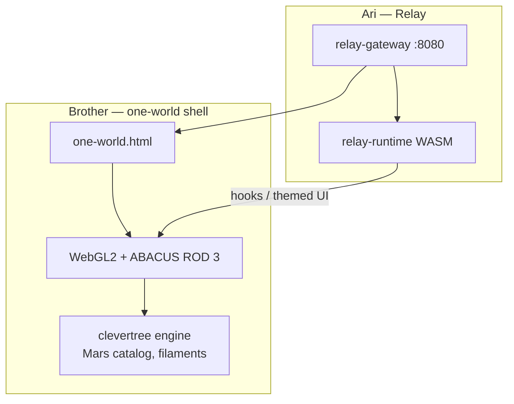

# Parallel project: One-World / ABACUS (brother's stack)

**Status snapshots:**

| Date | Event |
|------|--------|
| **2026-06-15** | Integration milestone — gateway + WASM + WebGL at 60fps |
| **2026-06-21** | Product thesis clarified in defense/cyber conversation (see § Product thesis below) |

This document describes the **parallel project** running alongside Relay: a **WebGL2 universe** (“one-world”) that hosts **relay-runtime** (CleverScript in WASM). Written for Ari’s side of the monorepo.

**Sources:** Instagram milestone log (2026-06-15), live desktop screenshot, **`21.06.2026 cursor_defense_contracts_and_technology.md`** (exported Cursor transcript, ~4:08–4:38 PM), Relay docs in this repo. Brother’s game repo is **not** checked out here; unverified paths are marked **observed**.

---

## One-sentence summary

**A unified spatial shell over fragmented systems and opaque programs** — WebGL world + ABACUS navigation + Relay hooks — aimed at the “app-to-app migration” and “too much tech, not enough experts” problems, not at being a second messaging or security app.

---

## What each brother owns

| Layer | Owner | Technology | Role |
|-------|-------|------------|------|
| **HTTP static + Relay API** | Ari | `relay-gateway.exe` (Rust) | Serves `one-world.html`, hook source, theme YAML, repo mirrors on **port 8080** |
| **Hook runtime** | Ari | **relay-runtime** WASM (~**1.3 MB**), **CleverScript** | Parses and executes client hooks; browser JS is glue only ([WEB_WASM_HOST.md](WEB_WASM_HOST.md)) |
| **3D universe / game shell** | Brother | **WebGL2**, custom **clevertree** engine | Renders **one-world** at **60fps**; **ABACUS ROD 3** = live rod/world slice (e.g. **ROD 3 — EARTH**) |
| **Native desktop wrapper** | Brother (BUILDER-01) | **Tauri** (Rust shell, sidecar) | One Windows `.exe` = gateway + WASM + WebGL — no Electron |

---

## Product thesis (2026-06-21 update)

Analysis of **`21.06.2026 cursor_defense_contracts_and_technology.md`** — a ~30-minute conversation (Speaker A: Israeli enterprise cyber/accounting background; Speaker B: former Afghan-era defense contractor, embassy/intelligence network). Speaker labels are inferred from the export; **Speaker B aligns with the brother’s known background**.

### The problem one-world is aimed at (inferred)

The conversation does **not** mention ABACUS or one-world by name, but the through-line matches what the spatial project would need to sell:

| Pain (from transcript) | Quote / idea | Possible one-world answer |
|--------------------------|--------------|---------------------------|
| **App-to-app migration** | “What just happened is the biggest issue… migration from app to app.” Secure apps “offer the same thing… messaging claiming to be more secure. That’s not a market selling point.” | **One shell** instead of hopping Signal → settings → VPN → next app |
| **Fragmentation** | “You can’t train 1,000 professionals on 10,000 different systems… settings panels of one system don’t match another… knowledge gap… just to migrate.” | **One spatial model** (rods, filaments, catalogs) over many repos/sources |
| **Change without mapping** | DOGE / Musk = “changing firewall rules one at a time” without learning every rule first | **Map first, then navigate** — ABACUS observation grid, filament paths before “opening” content |
| **No verification** | “No CEO can check an IT team’s work — so there’s no enforcement.” Fake pentests = “screenshots, no proof.” | Thread ends on **“You know what unit testing is?”** — verifiable, reproducible behavior vs. claims |
| **Opacity** | Wet/black/shade ops “aren’t funded by a budget on a gov system”; budget transparency = “No” (8200 contact) | **Citizens vs. governments** — need a credible alternative; “takes a spark” |
| **Expertise gap** | “Too much tech, not enough experts to manage it.” DAF $300k license, turned off, still paid. | Local-first stack (gateway + WASM + world) **you control**, not vendor soup |

### What this adds over “Relay in a browser tab”

Relay alone already delivers: gateway, hook execution, themed UI, git-mirrored content (e.g. paradigm-threat-files).

The brother’s layer is defensible **only if** it implements the thesis above:

1. **Unified navigation** — spatial/chronological map (filaments, rods) replaces tab-hopping and app migration.
2. **Mapped exploration** — see relationships (Mars → Earth filaments, star catalog) before diving into documents.
3. **Verifiable integration** — hooks load from readable source (Relay policy); world state and content links should be testable, not “screenshot security.”
4. **Alternative to opaque stacks** — personal/local archive (674 GB R2 sync, fleet) as counterweight to systems nobody can audit.

If WebGL is only backdrop, the project **is** “Relay with a cool background.” The June 21 conversation is the **articulation of why that would matter** if built — not proof it’s built yet.

### Defense / cyber context (background, not MVP scope)

Speaker B’s contractor past (Afghan-era programs, off-budget ops invisible to DOGE) and Speaker A’s gov/enterprise cyber war stories (MOE firewall, SAP GRC nobody buys, Burp-suite “pentests”) frame **motivation**, not v1 features. Do not conflate “explore paradigm-threat timeline in 3D” with “replace enterprise GRC.” The honest MVP stays: **one filament path → one readable hook in-world**.

---

## Milestone (2026-06-15): what was live

1. **`relay-gateway.exe`** serving **`one-world.html`** at **`:8080`**
2. **`relay-runtime` WASM** (~1.3 MB) — zero console errors
3. **One-world** at **60fps**, **ABACUS ROD 3** live
4. **WAN bond** (POCO ~72 Mbps), **R2** ~1.9 MB/s, **674 GB** verified
5. **Fleet:** CHRONO, AYLA, MELCHIOR, **BUILDER-01** (Tauri build in progress)

**Integration MVP:** ✅ Ari’s engine runs inside the brother’s world.

**Product MVP:** ❌ Not demonstrated — no external testers; no end-to-end “navigate → read” story.

---

## MVP status (recommended focus)

| Level | Definition | Status |
|-------|------------|--------|
| **Integration** | Gateway + WASM + WebGL, clean console, 60fps | ✅ Done (Jun 15) |
| **Shippable** | Tauri `.exe`, gateway sidecar auto-starts | 🔄 BUILDER-01 |
| **Product** | 1–2 **non-builders** complete: open → one filament → one in-world document; can state what app is *for* without coaching | ❌ **No testers yet** (as of Jun 21) |

**Blocker called out internally:** Milestone posts prove plumbing, not user value. Recruit testers **before** more fleet/R2/Tauri polish.

---

## Architecture (browser)

**Observed clevertree assets:** `mars-star` catalog (41 stars), `mars-comment-filaments.json`, 12 filaments Mars → Earth nav-targets.

---

## Architecture (next: Tauri / BUILDER-01)

- Tauri webview hosts `one-world.html`
- **`relay-gateway.exe`** as sidecar (`RELAY_STATIC_DIR`, `RELAY_HTTP_PORT`, `RELAY_REPO_PATH`)
- No Electron, no Node on hook path

---

## Fleet & infra (observed)

| Node | Inferred role |
|------|----------------|
| **CHRONO** | Chronology / timeline / sync |
| **AYLA**, **MELCHIOR** | Fleet peers |
| **BUILDER-01** | Tauri native build |

R2 archive sync (~674 GB) = brother-side corpus mirror, not user-facing MVP.

---

## Relation to relay-runtime (Ari)

- **relay-runtime** = only hook execution engine ([POLICY.md](POLICY.md))
- Brother’s world = host + spatial model; Relay = transparent UI + content
- Shared Clevertree ecosystem: paradigm-threat-*, Forgotten Future (longer game vision on forgottenfuturebook.com)

---

## Open questions

- Exact git remote for one-world / ABACUS
- WebGL + WASM DOM layout (iframe vs overlay)
- First hook/content wired to filament navigation
- Confirm Speaker B = brother in Jun 21 transcript (likely, not verified)

---

## Related docs

- [WEB_WASM_HOST.md](WEB_WASM_HOST.md) · [POLICY.md](POLICY.md) · [CLEVERSCRIPT.md](CLEVERSCRIPT.md)
- **`relay-gateway/docs/RELAY_FLEET_CONSOLE.md`** — Ari’s production fleet (separate from CHRONO/AYLA/MELCHIOR)
- **External:** `21.06.2026 cursor_defense_contracts_and_technology.md` — full transcript + Cursor summary

---

*Last updated: 2026-06-21.*
